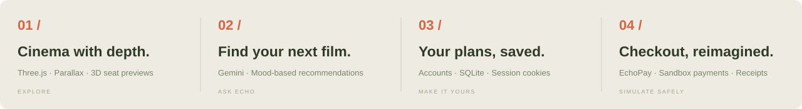
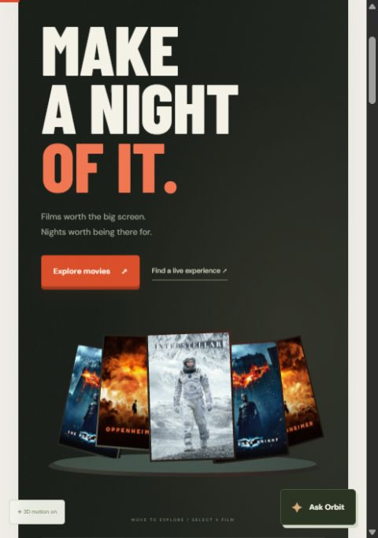
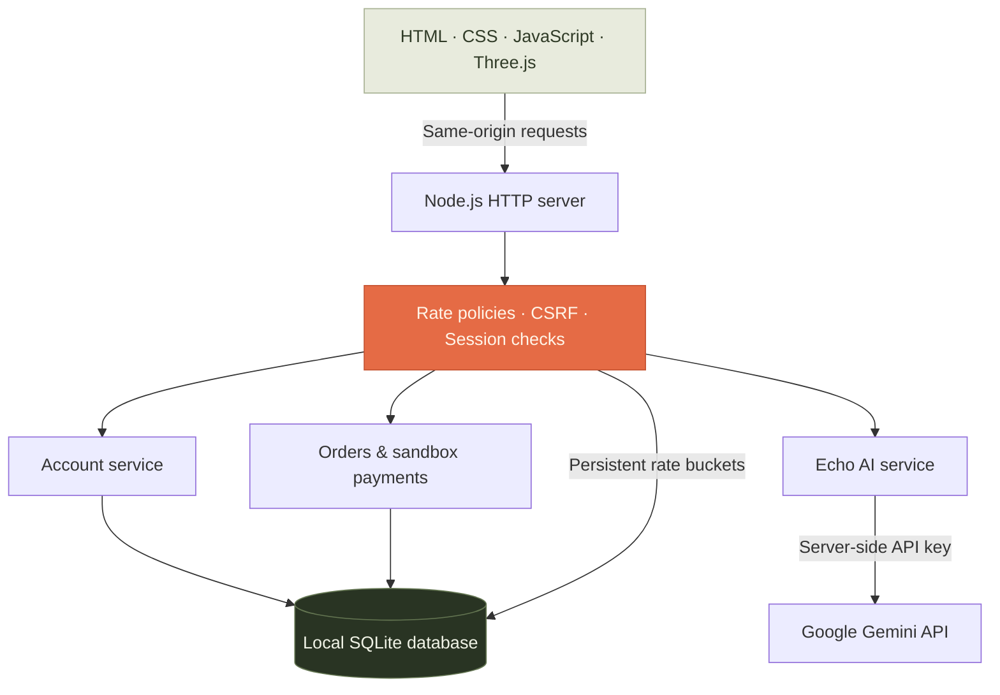

<div align="center">


**A cinema and live-experience platform with a little more dimension.**

3D discovery · AI recommendations · Account-backed bookings · A custom sandbox checkout


[Explore the experience](#the-experience) &nbsp; / &nbsp; [Run locally](#run-it-locally) &nbsp; / &nbsp; [Architecture](#under-the-hood) &nbsp; / &nbsp; [Security](#built-with-boundaries)

</div>

---

## Films worth the big screen. Nights worth being there for.

EchoMyShow brings movie discovery, Delhi experiences and ticket booking into one responsive interface. Browse a film wall in 3D, ask **Echo AI** for something that fits your mood, choose a cinema and seats, then follow your booking through **EchoPay** to a saved demo receipt.

This is an independent project inspired by BookMyShow. Listings are sample data, and payments are simulations.



## The experience

<table>
<tr>
<td width="38%" align="center">

</td>
<td width="62%">
<h3>A little depth changes the view.</h3>
<p>A charcoal, ivory and vermilion interface built around cinema rather than dashboards. Real-time poster geometry, scroll parallax and layered surfaces bring the browsing experience to life.</p>
<p><strong>19 dedicated pages</strong><br>Movies, streaming discovery, live events, theatre, sports, activities, details, seat selection, accounts, AI, offers, gift previews, bookings and more.</p>
<p><strong>Motion with a choice</strong><br>Pointer-responsive cards, raised buttons, scroll reveals and a motion toggle. Reduced-motion preferences are respected.</p>
<p><strong>Delhi at the centre</strong><br>Delhi-NCR is the default location, with sample cinema and event venues throughout the experience.</p>
</td>
</tr>
</table>

### One evening. From idea to ticket.


| Made for | What you can do |
| :--- | :--- |
| **Movie nights** | Search titles, filter by language and genre, sort listings, view details and choose sample showtimes. |
| **Live moments** | Browse Delhi event categories, open an event page and reserve sample tickets. |
| **Finding your vibe** | Ask Gemini-powered Echo AI for film suggestions, spoiler-free choices and budget-aware plans. |
| **Your own account** | Register, sign in, edit your name, sign out and view bookings stored against your account. |
| **Choosing your view** | Use an interactive Three.js theatre preview alongside a labelled, accessible seat map. |
| **Trying checkout** | Select demo UPI, a preset test card or demo wallet. Simulate success or decline and view a receipt. |

## Run it locally

**You need Node.js 24+ and npm.** From this repository root, enter the application directory first:

```sh
cd orbitmyshow
npm install
npm start
```

Open **[http://localhost:5173](http://localhost:5173)**. The server binds to localhost by default and creates the local SQLite database on first use. No separate database installation or frontend build is required.

### Connect Echo AI

Copy [.env.example](orbitmyshow/.env.example) to `.env`, then fill in your server-side Gemini key:

```dotenv
PORT=5173
HOST=127.0.0.1
GEMINI_API_KEY=your_gemini_api_key
GEMINI_MODEL=gemini-2.5-flash
```

Restart the server after changing environment settings. Without a key, the rest of the application works and the concierge explains that AI is not configured. Your key belongs in the environment—not in browser code. `.env` and the local database are ignored by Git.

### Your local destinations

| Page | Address |
| :--- | :--- |
| Discover | [localhost:5173](http://localhost:5173/) |
| Movies | [movies.html](http://localhost:5173/movies.html) |
| Events | [events.html](http://localhost:5173/events.html) |
| Echo AI | [ai.html](http://localhost:5173/ai.html) |
| Your account | [account.html](http://localhost:5173/account.html) |
| My bookings | [bookings.html](http://localhost:5173/bookings.html) |
| Cookie information | [privacy.html](http://localhost:5173/privacy.html) |

## Under the hood



```text
.
├── dist/                       Frontend pages, styles and interactions
│   ├── assets/                 Film artwork and poster fallbacks
│   ├── vendor/                 Three.js modules and license
│   ├── design.js / design.css  Shared art direction and scroll effects
│   ├── experience.js           Accounts, AI and checkout controllers
│   └── scene.js                Real-time film gallery and theatre
├── backend/
│   ├── app.cjs                 HTTP routing and request validation
│   ├── security.cjs            Password hashing, sessions and CSRF support
│   ├── database.cjs            SQLite schema and connection
│   ├── catalog.cjs             Sample listings and authoritative prices
│   ├── payments.cjs            Orders, seat holds and sandbox payments
│   ├── ai.cjs                  Gemini integration
│   └── rate-limit.cjs          Persistent throttling and work gates
├── tests/                      Backend and abuse-control tests
├── docs/assets/                Graphics and screenshot for this README
├── .env.example                Environment template, without secrets
└── server.cjs                  Local application entry point
```

## Built with boundaries

| Layer | What is implemented |
| :--- | :--- |
| **Accounts** | Scrypt password hashes with unique salts; HttpOnly, SameSite session cookies; session rotation after sign-in. |
| **Requests** | CSRF tokens on API mutations, same-origin checks, a 16 KB JSON-body limit and HTTP timeouts. |
| **Bookings** | Prices calculated on the server, 10-minute seat holds, conflict detection and idempotent successful payments. |
| **Abuse controls** | SQLite-backed token buckets, IP/account/email scopes, app-wide AI budget and concurrency caps. |
| **Privacy controls** | Essential cookie handling, optional motion preferences and no application analytics or advertising cookies. |
| **Secrets** | Gemini calls run on the server; the API key is not shipped with frontend assets. |

<details>
<summary><strong>Rate-limit policies and deployment notes</strong></summary>

Buckets refill gradually. The sustained refill rate and immediate burst capacity are both enforced, including failed requests.

| Scope | Sustained refill | Burst |
| :--- | :--- | ---: |
| All traffic / IP | 600 per minute | 180 |
| API / IP | 180 per minute | 60 |
| New anonymous sessions / IP | 30 per minute | 15 |
| Login and registration / IP | 20 per 15 minutes | 20 |
| Login and registration / normalized email | 8 per 15 minutes | 8 |
| Registration / IP | 5 per hour | 5 |
| AI / IP and signed-in user | 8 per minute | 4 |
| AI / entire application | 100 per hour | 20 |
| Orders / IP | 30 per minute | 15 |
| Orders / user | 12 per minute | 8 |
| Payments / IP | 20 per minute | 10 |
| Payments / user | 10 per minute | 6 |
| Profile updates / user | 12 per minute | 6 |
| Cookie updates / IP | 12 per minute | 6 |

Blocked requests return `429`, `Retry-After` and rate-limit headers. The UI shows the delay without automatically replaying mutations. Password work is capped at **4** concurrent tasks, and AI at **2**. Rate-bucket storage is capped at **10,000 active keys** and rejects new keys when full.

Counters persist across restarts and processes sharing the same SQLite file. IPs come from the socket; client-supplied proxy headers are ignored. A proxy therefore shares its IP budget across clients until explicitly trusted proxy handling is added. Separate hosts or databases need a shared limiter and upstream traffic protection. Rate limiting reduces abuse; it cannot prevent every exploit.

</details>

## Check the project

```sh
npm run check   # JavaScript syntax and shared design across all pages
npm test        # Backend integration and rate-limit tests
```

The test suite covers account access, CSRF, server-side prices, seat conflicts, expired holds, payment idempotency, declines, burst/refill behavior, persistent counters, concurrency, spoofed proxy headers and AI budgets. Tests use isolated databases and mocked AI replies, so they do not call the paid Gemini API.

## What is real, and what is a demo?

**Working locally:** account authentication, SQLite persistence, order creation, seat holds, rate limiting and Gemini responses when configured.

**Simulated:** cinema availability, event listings, payment methods, wallet credits, offers and gift previews. Demo tickets are **not valid for venue admission**. No actual card numbers, bank credentials or UPI details are requested or stored. Newsletter and partner-enquiry forms do not deliver emails.

The full application needs the Node server; serving only `dist/` does not provide accounts, AI or checkout. Before selling actual tickets, it needs live inventory, a merchant payment provider, verified payment webhooks, production identity/recovery flows and suitable HTTPS hosting.

## Credits

Built with **Node.js**, **Three.js**, **SQLite** and **Google Gemini**. Movie artwork uses TMDB image URLs, with local artwork fallbacks; atmosphere photography uses Unsplash and fonts load from Google Fonts. Three.js license information is included in [dist/vendor/THREE-LICENSE.txt](orbitmyshow/dist/vendor/THREE-LICENSE.txt).

EchoMyShow is not affiliated with BookMyShow. Third-party artwork and brands belong to their respective owners.

---

<div align="center">

**ECHO • MYSHOW**

*Go make a night of it.*

[Back to the top ↑](#)

</div>
